# Robin: Engineers vs AI

A small game of Battleship about software engineers and AI. It's meant to build empathy, not dread.

You are an engineer working the night shift. Your fleet is your work: **The Side Project**,
**The Promotion**, **The Open-Source Lib**, **The Pet Project** and **The Weekend Hack**. Across
four chapters an AI opponent gets steadily better at finding them, and it comments on every move,
clumsy at first and unnervingly sure by the end. In the last chapter you can keep fighting, or team
up with the AI, your sidekick, against a shared Production Incident. Teaming up is the only way the
story ends.

**Play:** <https://tejasbaldev.github.io/robin/>

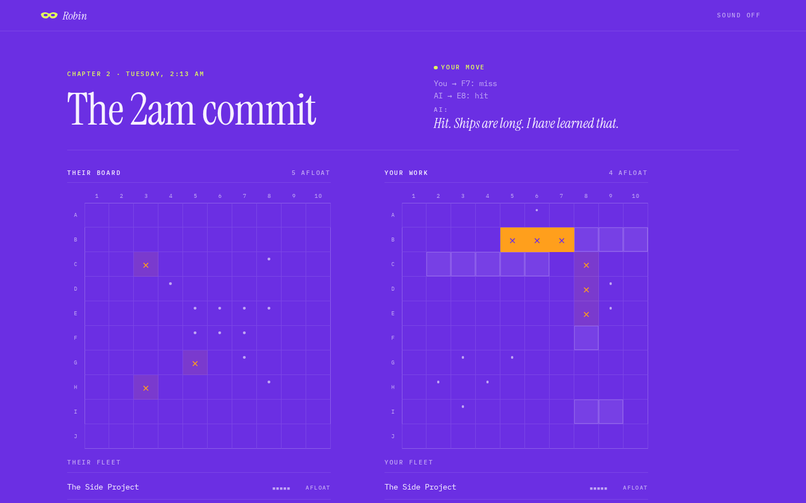

## The story

| Chapter | Scene                                | Ground    | The AI                                            |
| ------- | ------------------------------------ | --------- | ------------------------------------------------- |
| 1       | Standup, Monday 9:30 AM              | Cobalt    | Tier 1: fires at random                           |
| 2       | The 2am commit, Tuesday 2:13 AM      | Violet    | Tier 2: hunt and target, probing around every hit |
| 3       | Performance review, Thursday 3:00 PM | Tangerine | Tier 3: aims where a ship is most likely to be    |
| 4       | The pager, Saturday 3:47 AM          | Green     | Tier 3, then a choice: keep fighting, or team up  |

- Each chapter opens with a short typed interstitial. It changes depending on whether you won the
  chapter before.
- Losing a chapter never ends the game; later chapters remember how it went.
- In Chapter 4, "Keep fighting" plays a short Tier 3 match, the incident gets worse and the choice
  comes back.
- "Team up" puts you and the AI on one board against the incident. A faint glow shows where the AI
  thinks the incident is hiding.
- After the ending, an optional click-through introduces Devin and Cognition's tools, and ends with
  a sign-up link.

| Title                                                  | Interstitial                                                    |
| ------------------------------------------------------ | --------------------------------------------------------------- |
| 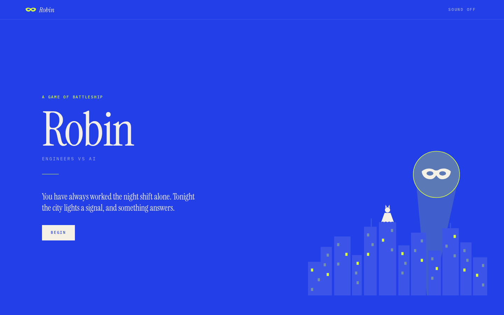         | 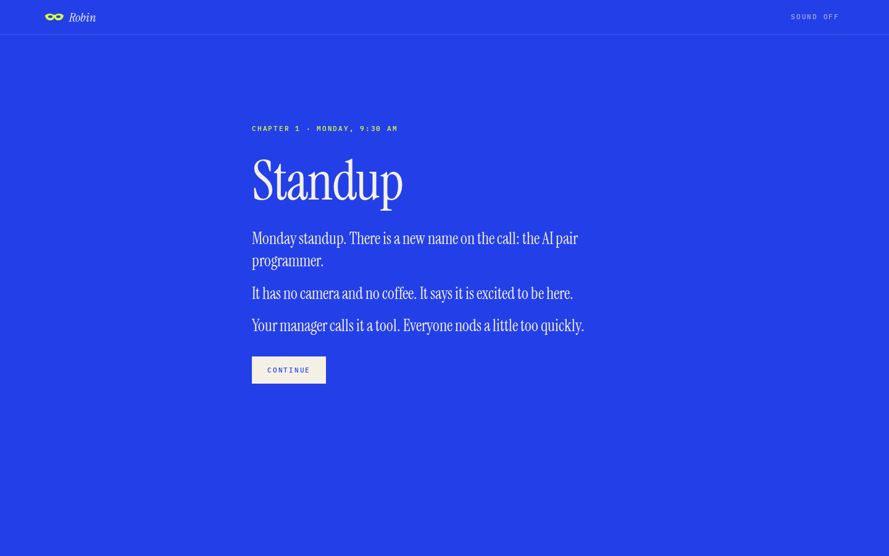 |
| **Placement**                                          | **Chapter 1 battle**                                            |
| 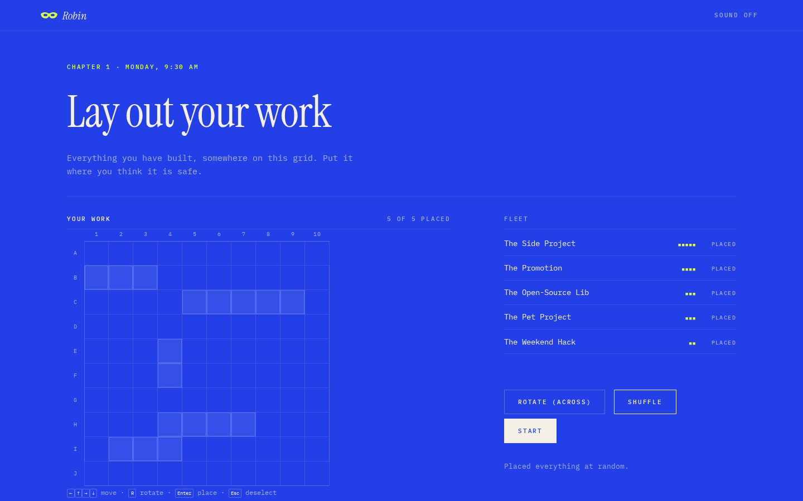        | 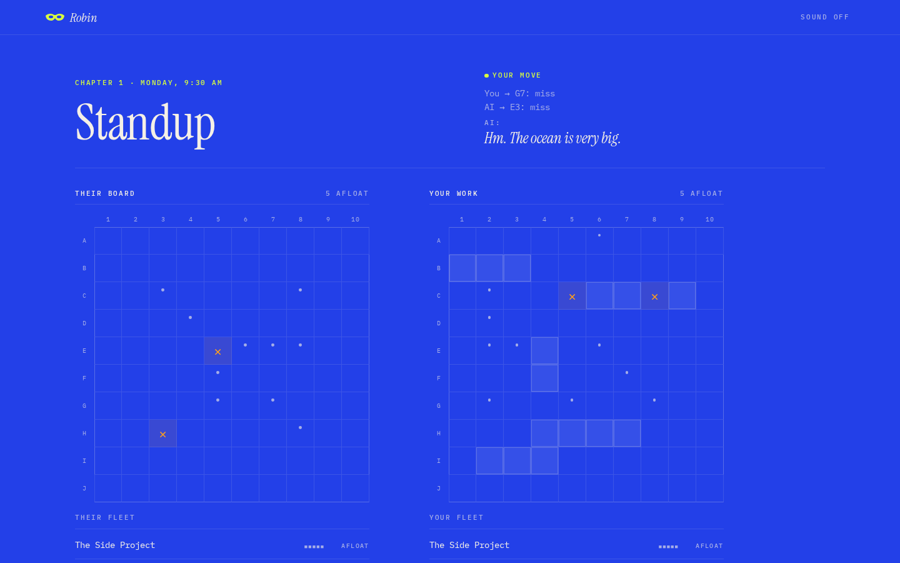           |
| **Chapter 3 battle**                                   | **The choice**                                                  |
| 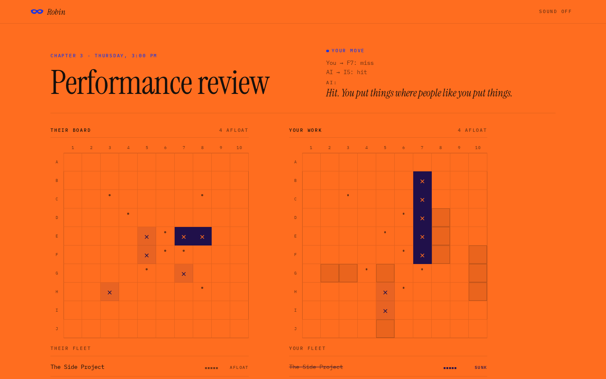  | 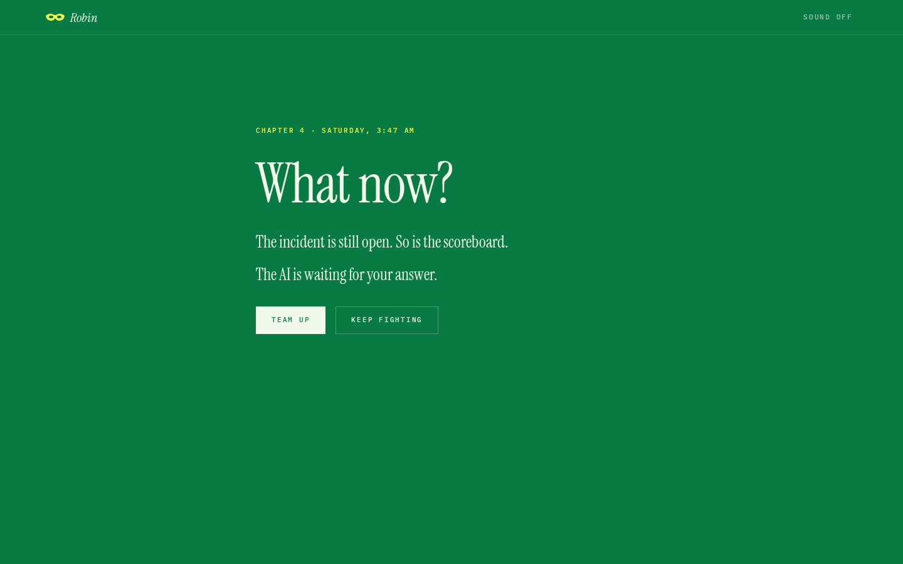                   |
| **Co-op against the incident**                         | **The ending**                                                  |
| 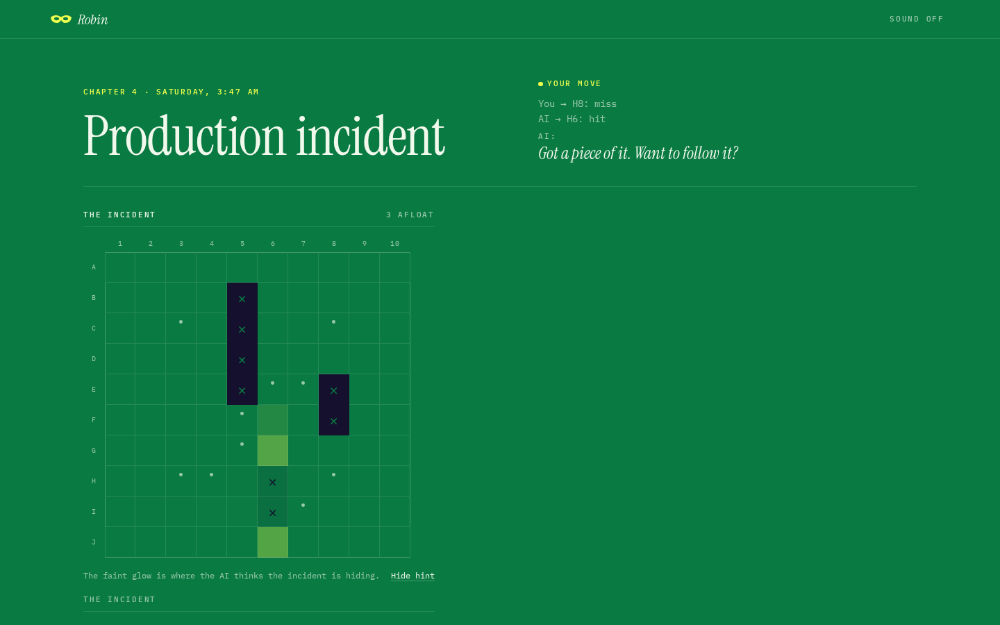                 | 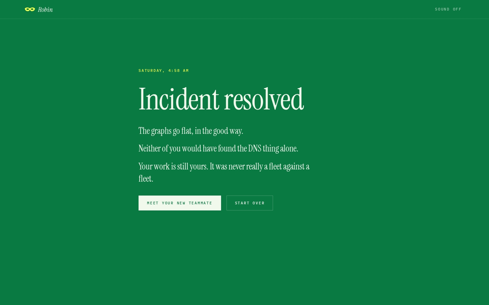                   |
| **Meet your new teammate**                             | **Your first project**                                          |
| 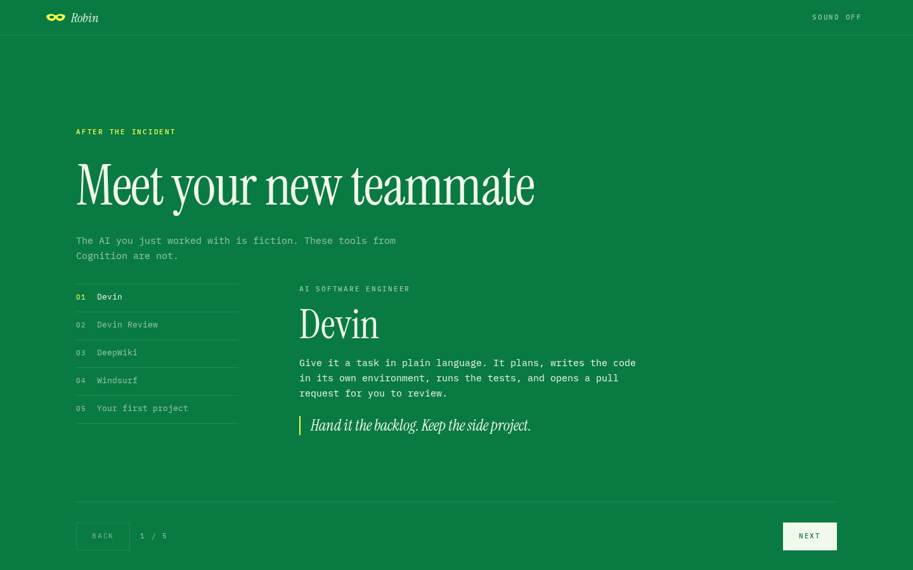 | 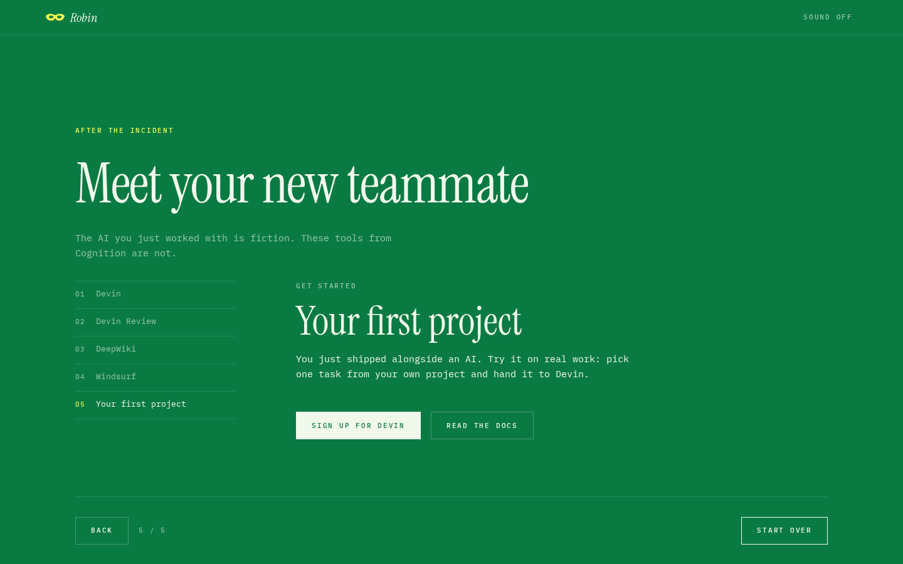          |

On a phone the boards stack, with the target board first:

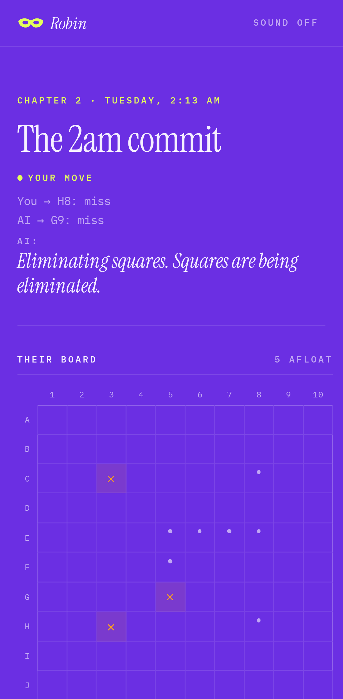

## How to play

- **Placement:** choose a ship, then click a cell or press **Enter** to place it. **R** rotates
  the ship, **Esc** deselects it, and **Shuffle** places the whole fleet at random.
- **Battle:** fire at their board. The AI fires back after each of your shots. **×** is a hit,
  **·** is a miss, and a solid cell is a sunk ship.
- **Keyboard:** each board is one Tab stop. Use the arrow keys, Home/End and Ctrl+Home/End to
  move, and Enter or Space to act. Every cell has a screen-reader label with its coordinate and
  state.
- **Saving:** progress is saved in your browser, down to the last shot. Reload and press
  **Continue** to pick up where you left off; **Begin** or **Start over** clears it.
- **Sound:** off by default. The switch in the top-right corner turns on a generated ambient score
  whose tension rises each chapter and eases off in co-op, plus small cues for hits and sinks.
- **Motion:** only hits, sinks and chapter changes animate, and nothing does when your system asks
  for reduced motion.

## Design

- **Type:** Instrument Serif for headings, story lines and the AI's voice; IBM Plex Mono for
  everything else. Both are self-hosted.
- **Colour:** each chapter has its own saturated ground (cobalt, violet, tangerine, green) with
  ink or paper type on top. Hit markers keep at least 3:1 contrast on every ground.
- **Artwork:** an original SVG night city with a signal in the sky and a sidekick's domino mask.
  No third-party characters or logos.
- **Boards:** CSS Grid, no Canvas.

## Develop

Requires Node 22 (see `.nvmrc`).

```sh
npm install
npm run dev        # http://localhost:5173/robin/
npm run check      # lint, format check, typecheck, unit tests, build (what CI runs)
npm run test:e2e   # Playwright, desktop and mobile
```

For reviewing and testing, the URL accepts `?chapter=1-4&tier=1|2|3&seed=N&delay=MS`. These start
a new campaign at a chapter, override the AI tier, fix the seed and set the AI's pause (up to
10,000 ms).

All story copy (interstitials, commentary, ship names, the ending and the Devin tour) lives in
[`src/story/chapters.ts`](src/story/chapters.ts). You can edit it without touching any logic.

### Structure

```
src/
  engine/       pure game logic: board, placement, match reducer, chapter flow, seeded RNG
  ai/           Tier 1 random, Tier 2 hunt/target, Tier 3 probability density, all behind
                chooseShot(boardView, history)
  story/        all copy, plus the code that picks lines
  persistence/  versioned localStorage: campaign progress, the match in progress, settings
  ui/           React screens, components and hooks; music and sound via Web Audio
e2e/            Playwright tests, desktop and mobile
```

Layers only depend downwards: `ui → story, persistence, ai → engine`. The engine has no React or
DOM code, and all randomness comes from an injected seeded RNG, so every game can be replayed.
The match in progress is saved as the list of moves made, and a reload replays them through the
engine, so a damaged or edited save falls back to a fresh match instead of breaking the game.

The project rules and conventions are in [`AGENTS.md`](AGENTS.md).

### Tests

- 176 Vitest unit tests cover the engine, the AI tiers (for example, Tier 2 always probes next to a
  hit), story selection and saving.
- 15 Playwright tests run on both desktop and a Pixel 7 viewport. They cover keyboard placement, a
  full chapter, the Chapter 4 choice through to the tour, reload resume and reduced motion.

## Deploy

Every push to `main` runs [`.github/workflows/deploy.yml`](.github/workflows/deploy.yml), which
checks and builds the site and publishes `dist/` to GitHub Pages. It needs a one-time setting:
**Settings → Pages → Source: GitHub Actions**. Pull requests run CI (lint, typecheck, unit tests,
build and Playwright) through [`.github/workflows/ci.yml`](.github/workflows/ci.yml).

## Build history

The early scaffolding began in another tool (Claude Code) before the project moved to Devin. It
was built in reviewed pull requests:

| PR                                                  | Change                                                     | Built with  |
| --------------------------------------------------- | ---------------------------------------------------------- | ----------- |
| [#1](https://github.com/tejasbaldev/robin/pull/1)   | Scaffold, tooling and CI                                   | Claude Code |
| [#2](https://github.com/tejasbaldev/robin/pull/2)   | Game engine                                                | Claude Code |
| [#3](https://github.com/tejasbaldev/robin/pull/3)   | AI tiers 1–3                                               | Claude Code |
| [#4](https://github.com/tejasbaldev/robin/pull/4)   | Placement and battle UI                                    | Claude Code |
| [#5](https://github.com/tejasbaldev/robin/pull/5)   | Story layer: chapters, commentary, co-op ending            | Devin       |
| [#6](https://github.com/tejasbaldev/robin/pull/6)   | Polish: motion, sound, mobile, accessibility, Pages deploy | Devin       |
| [#7](https://github.com/tejasbaldev/robin/pull/7)   | Editorial redesign and saturated chapter colours           | Devin       |
| [#8](https://github.com/tejasbaldev/robin/pull/8)   | Hit-marker contrast on every chapter ground                | Devin       |
| [#9](https://github.com/tejasbaldev/robin/pull/9)   | Generative ambient score                                   | Devin       |
| [#10](https://github.com/tejasbaldev/robin/pull/10) | Music resync after a background tab                        | Devin       |
| [#11](https://github.com/tejasbaldev/robin/pull/11) | Devin and Cognition tour, with a sign-up call to action    | Devin       |
| [#12](https://github.com/tejasbaldev/robin/pull/12) | Rename from Brutus to Robin, with original artwork         | Devin       |
| [#14](https://github.com/tejasbaldev/robin/pull/14) | Fix two hangs found by a full-codebase review              | Devin       |
| [#15](https://github.com/tejasbaldev/robin/pull/15) | Resume the match in progress after a reload                | Devin       |
| [#16](https://github.com/tejasbaldev/robin/pull/16) | Reload follow-ups: next ship to place, same AI shots       | Devin       |
