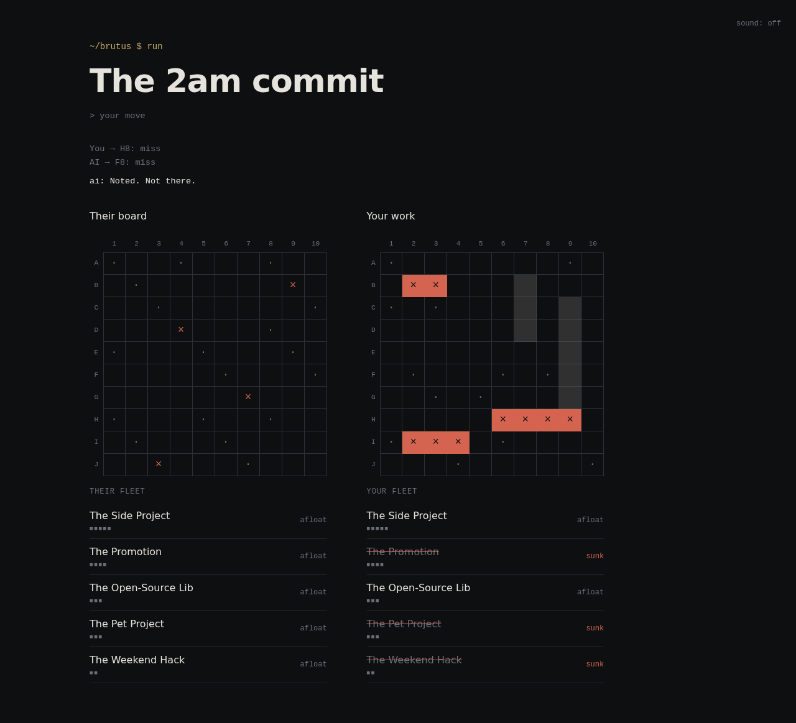

# Robin: Engineers vs AI

A small game of Battleship about software engineers and AI. It's meant to build empathy, not dread.

Your fleet is your work: **The Side Project**, **The Promotion**, **The Open-Source Lib**,
**The Pet Project** and **The Weekend Hack**. Across four chapters (a standup, a 2am commit, a
performance review and a page at 3:47 AM) an AI opponent gets steadily better at finding them.
It comments on every move, clumsy at first and unnervingly sure by the end. Losing a chapter
never ends the game; later chapters remember how it went. In the last chapter you can keep
fighting, or team up with the AI against a shared Production Incident. Teaming up is the only
way the story ends.

**Play:** <https://tejasbaldev.github.io/robin/>



## How to play

- **Placement:** choose a ship, then click a cell or press **Enter** to place it. **R** rotates
  the ship, **Esc** deselects it, and **Shuffle** places the whole fleet at random.
- **Battle:** fire at their board. The AI fires back after each of your shots. **×** is a hit,
  **·** is a miss, and a solid cell is a sunk ship.
- **Keyboard:** each board is one Tab stop. Use the arrow keys, Home/End and Ctrl+Home/End to
  move, and Enter or Space to act.
- Progress is saved in your browser, down to the last shot: reload and press Continue to pick up
  where you left off. Sound is off by default; turn it on with the switch in the top-right corner.
  Animations are skipped when your system asks for reduced motion.

## Develop

Requires Node 22 (see `.nvmrc`).

```sh
npm install
npm run dev        # http://localhost:5173/robin/
npm run check      # lint, format check, typecheck, unit tests, build (what CI runs)
npm run test:e2e   # Playwright, desktop and mobile
```

For reviewing and testing, the URL accepts `?chapter=1-4&tier=1|2|3&seed=N&delay=MS`. These
start a new campaign at a chapter, override the AI tier, fix the seed and set the AI's pause.

All story copy (interstitials, commentary, ship names, the ending) lives in
[`src/story/chapters.ts`](src/story/chapters.ts). You can edit it without touching any logic.

### Structure

```
src/
  engine/       pure game logic: board, placement, match reducer, chapter flow, seeded RNG
  ai/           Tier 1 random, Tier 2 hunt/target, Tier 3 probability density, all behind
                chooseShot(boardView, history)
  story/        all copy, plus the code that picks lines
  persistence/  versioned localStorage saves and settings
  ui/           React screens, components and hooks; CSS Grid boards
e2e/            Playwright tests
```

The project rules and conventions are in [`AGENTS.md`](AGENTS.md).

## Deploy

Every push to `main` runs [`.github/workflows/deploy.yml`](.github/workflows/deploy.yml), which
checks and builds the site and publishes `dist/` to GitHub Pages. It needs a one-time setting:
**Settings → Pages → Source: GitHub Actions**. Pull requests run CI (lint, typecheck, unit tests,
build and Playwright) through [`.github/workflows/ci.yml`](.github/workflows/ci.yml).

## Build history

The early scaffolding began in another tool (Claude Code) before the project moved to Devin. It
was built in reviewed phases, one pull request each:

1. Scaffold, tooling and CI ([#1](https://github.com/tejasbaldev/robin/pull/1)): Claude Code
2. Game engine ([#2](https://github.com/tejasbaldev/robin/pull/2)): Claude Code
3. AI tiers 1–3 ([#3](https://github.com/tejasbaldev/robin/pull/3)): Claude Code
4. Placement and battle UI ([#4](https://github.com/tejasbaldev/robin/pull/4)): Claude Code
5. Story layer: chapters, commentary, co-op ending ([#5](https://github.com/tejasbaldev/robin/pull/5)): Devin
6. Polish: motion, sound, mobile, accessibility, README, Pages deploy: Devin
7. Later: editorial redesign, chapter colours, music, the Devin tour, and the rename from Brutus to Robin: Devin
